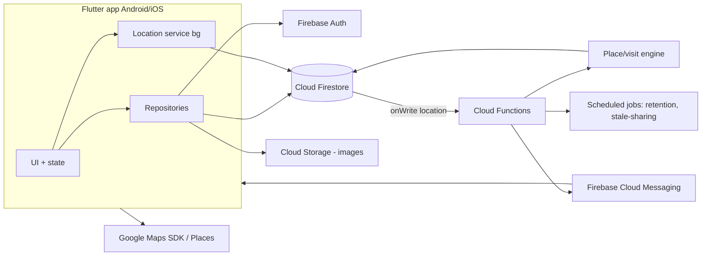

# Circlo — Architecture (DRAFT v0.1)

> **Verification note:** Technology versions, quotas, pricing and OS policies below were **not** re-verified against official documentation when this draft was written. Verification is a mandatory task before implementation (see [docs/risks.md](docs/risks.md) R-10).

## 1. Overview
Flutter mobile client + Firebase backend (serverless). Authorization is enforced by Firestore Security Rules and Cloud Functions; the client is untrusted.



## 2. Technology recommendations
| Area | Choice | Why | Alternatives |
|---|---|---|---|
| Client | Flutter (stable), Riverpod state mgmt, go_router | One codebase; matches source doc | React Native; native x2 (higher cost) |
| Auth | Firebase Authentication (email/password) | Managed, secure, password reset | Supabase Auth |
| DB | Cloud Firestore | Realtime listeners fit live map; rules model | Supabase/Postgres+PostGIS (better geo/history queries, relational); consider if cost/history volume grows |
| Push | FCM | Standard | — |
| Maps | Google Maps Platform (maps_flutter, Places) | Source doc | Mapbox, OpenStreetMap (cheaper) |
| Background location | `flutter_background_geolocation` (commercial licence for Android) **or** `geolocator` + foreground service — chosen after a spike (ADR-0003) | Reliability of background tracking is highest technical risk | Native plugins |
| Backend | Cloud Functions (TypeScript, 2nd gen) | Serverless | Cloud Run |
| Security | Firebase App Check, Security Rules, rules unit tests (emulator) | Prevent abuse | — |
| CI/CD | GitHub Actions: analyze, test, rules tests, build | — | Codemagic |

Simplicity note: no custom servers, no extra databases in MVP.

## 3. Requirements ↔ components
See [docs/traceability.md](docs/traceability.md). Summary: Auth (FR-001–007) → Auth+profile module; Circles (FR-010–022) → circles module + `joinCircle` function; Live location (FR-030–038) → location service + `liveLocations`; Places (FR-040–051) → places module + place engine; History (FR-060–068) → history module + visit builder; Notifications (FR-080–084) → notification module + FCM.

## 4. Repository structure (proposed)
```
/app                 Flutter project (lib/features/{auth,circles,map,places,history,notifications,settings}, lib/core)
/functions           Cloud Functions (TypeScript)
/firebase            firestore.rules, firestore.indexes.json, storage.rules, firebase.json
/firebase/tests      security-rule tests
/design /docs        documentation
/.github/workflows   CI
```

## 5. Data model
Detailed in [docs/data-model.md](docs/data-model.md).

## 6. APIs
Client talks to Firestore directly (rules-protected) for reads/simple writes; sensitive operations are **callable Functions**: `createCircle`, `joinCircle(code)`, `approveRequest`, `removeMember`, `transferOwnership`, `deleteCircle`, `rotateJoinCode`, `deleteMyHistory`, `deleteAccount`. Errors return typed codes (`invalid-code`, `expired`, `rate-limited`, `permission-denied`, `circle-full`).

## 7. Place alerts (arrival/departure) — design
Per [ADR-0002](docs/decisions/ADR-0002-server-side-place-detection.md): each location write triggers a function that evaluates the member's position against that circle's places.
- Per (member, place) state: `outside | inside` with `enteredAt`, `lastNotifiedEnterAt`.
- **Enter:** inside radius for ≥2 consecutive fixes or ≥2 min with accuracy ≤100 m → mark inside, send *arrived* once.
- **Exit:** outside radius × 1.2 (hysteresis) for ≥2 consecutive fixes/≥2 min → send *left* once.
- Dedup key `memberId_placeId_visitId` written in a transaction (idempotent on function retries).
- Alerts go only to users who enabled that place/member/type and are still circle members.

## 8. Security & privacy
Detailed in [docs/security-privacy.md](docs/security-privacy.md). Highlights: default-deny rules; membership checks via `circles/{id}/members/{uid}` docs; share-flag checks; join codes in separate collection, rate-limited, App Check enforced; no real secrets in repo; Maps API keys restricted by app signature/bundle ID; no analytics/ad SDKs.

## 9. Performance & cost control
- Adaptive location: moving (e.g. every 15–30 s / 50 m distance filter) vs stationary (significant-change/≥5 min). Values tuned in spike.
- Live location doc overwritten (1 write/update); history points sampled (≥50 m or ≥2 min) and batched.
- Firestore TTL policy deletes expired history; scheduled function enforces user retention.
- Cost estimate model to be produced before approval (R-04). Budget alerts on.

## 10. Reliability, logging, monitoring
Crashlytics; Functions structured logs; alerts on function error rate; stale-sharing job (every 5 min) flags members with no update ≥15 min; FCM token cleanup on failure.

## 11. Local dev, build, deploy, rollback
Firebase Emulator Suite locally; separate Firebase projects `circlo-dev`, `circlo-staging`, `circlo-prod`; env config via `--dart-define`/Firebase config files excluded from repo where sensitive; deployments by tagged release, manual approval; rollback by redeploying previous tag (functions/rules are versioned in Git); Firestore data migrations are scripted, reversible, run only with approval.

## 12. Key risks and trade-offs
Background location reliability (OEM battery killers, iOS review); Firestore cost with high write rates; geofence correctness; privacy/legal for minors. See [docs/risks.md](docs/risks.md).

## 13. Cost-sensitive dependencies
Google Maps/Places/Geocoding, Firestore reads/writes, Functions invocations, FCM (free), Storage, possibly background-location plugin licence, Apple Developer fee, Google Play fee.
