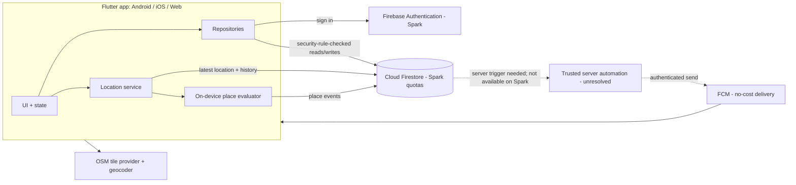

# Circlo — Architecture (DRAFT v0.3 — Firebase-only)

**Owner decisions (2026-10-13):** monthly budget **$0**, no billing account; Flutter app for **web, Android, iOS**; **Firebase-only** (Authentication + Cloud Firestore + FCM); minors may use the app; native Android/iOS background tracking should continue when screen is locked, subject to OS permissions and restrictions.

> **Billing/security constraint:** Firebase Spark provides Firestore free quotas, Authentication (most methods), and FCM. Cloud Functions require Blaze. Therefore Firebase-only + no billing currently has no approved trusted server to send cross-user FCM messages, run scheduled cleanup, or perform privileged workflows. Do not put service credentials in the client or let clients perform privileged operations. Verify all quotas and provider terms before release.

## 1. Overview
Flutter client (web, Android, iOS) → Firebase Authentication + Cloud Firestore (Spark free quotas) → FCM for push delivery. Maps use OpenStreetMap-based tiles. No billing account is linked. Secure server-triggered push/maintenance operations remain blocked pending a zero-cost server design.



## 2. Technology recommendations
| Area | Choice | Why / cost | Alternatives |
|---|---|---|---|
| Client | Flutter, Riverpod, go_router | One codebase for web/Android/iOS; free | — |
| Login | Firebase Authentication, email+password (Spark) | Owner-selected Firebase-only stack; free quota for most methods |
| Data | Cloud Firestore on Spark | Native Firebase client integration, realtime listeners, free daily quotas; security rules required | Relational SQL model not available; query design must be deliberate |
| Server logic | No trusted server approved yet | Strict no-billing rule excludes Cloud Functions; sensitive actions must not be trusted to client | Reconsider a free external server only with owner approval |
| Push | FCM delivery; trusted sending path unresolved | FCM itself is no-cost, but remote sends require a trusted sender | Local notifications only for device-local events until a secure sender exists |
| Maps | `flutter_map` + free OSM-based tiles | No billing; works on web/Android/iOS | Google Maps (needs billing account) |
| Place search | Free geocoder (e.g. Nominatim/Photon) with rate limiting & caching | Free; usage policies limit autocomplete | Paid geocoding |
| Directions | Open device/web maps app via URL | Free | In-app routing (paid) |
| Background location | Plugin chosen by spike (ADR-0003); free option preferred | Highest technical risk | — |
| CI | GitHub Actions (free quotas for public repos; verify) | — | — |
| Hosting (web) | GitHub Pages / Firebase Hosting free quota / Cloudflare Pages (decide in Phase 6) | Free | — |

## 3. Platform behavior
| Platform | Background sharing | Notes |
|---|---|---|
| Android | Yes (foreground service + persistent notification) | Free distribution via APK/GitHub Releases; Play Store has a one-time developer fee (verify) |
| iOS | Yes ("Always" permission, system indicator) | Public distribution/TestFlight needs a paid Apple Developer account; builds need macOS (cloud CI) |
| Web | **No.** Browsers cannot track in the background. Web = view map/history/manage circles; shares location only while the tab is open (optional) | Web push requires service worker & user permission |

The $0 budget means store fees are outside budget; the code targets all three platforms, **distribution** of iOS/Play follows when the owner can pay (Q1).

## 4. Repository structure (proposed)
```
/app           Flutter project (lib/features/{auth,circles,map,places,history,notifications,settings}, lib/core)
/firebase      firestore.rules, firestore.indexes.json, emulator tests, seed data (no secrets)
/.github       CI workflows (analyze, test, Firestore Rules tests, build, secret scan)
/design /docs  documentation
```

## 5. Data model → [docs/data-model.md](docs/data-model.md)

## 6. Privileged operations and current blocker
Operations requiring trusted authority include create/join circle, approval, member removal, ownership transfer, circle/account deletion, join-code rotation, push sending, retention cleanup, and stale-sharing checks. Firestore Security Rules must enforce all client-accessible reads/writes. Under Spark/no billing, no Cloud Functions may be deployed; do not fake server authority with client checks or ship an FCM server key. Before implementing the full MVP, choose and test a secure no-cost server mechanism or explicitly defer features requiring it.

## 7. Place alerts (supersedes earlier server-side proposal) — see [ADR-0002](docs/decisions/ADR-0002-place-detection.md)
Cloud Functions are unavailable under the strict Spark/no-billing constraint. Place detection runs on the sharing member's device; server-side validation/deduplication is still a desired security control but needs a trusted server, so client events must be treated as untrusted:
1. The app syncs the circle's saved places (id, lat, lon, radius) to the device.
2. The **sharing member's device** compares each location fix against those places in app code (no OS geofence limit applies).
3. State machine per (member, place): `outside → inside` after ≥2 consecutive fixes or ≥2 min with accuracy ≤100 m; `inside → outside` after the same persistence beyond radius × 1.2 (hysteresis).
4. On a transition the device inserts a `place_events` row with a unique `visit_id`; a unique constraint `(member, place, visit_id, type)` makes retries idempotent (no duplicates, FR-048).
5. **Blocked under current constraints:** a trusted sender must verify subscriptions and current membership before sending FCM. Until a secure server path is approved, cross-user remote push cannot be promised; never send from the client with a server credential.
Limitation: events depend on the member's app getting location updates; if the phone is off/killed, no event (shown as "location unavailable").

## 8. Security & privacy → [docs/security-privacy.md](docs/security-privacy.md)

## 9. Free-tier budget model (to validate in spike)
- Firestore free quota (verify current console values) → sample history points (≥50 m or ≥2 min while moving, none while stationary), default retention 30 days, per-user caps, and explicitly tested cleanup. Firestore TTL/managed deletion is not available without billing; client cleanup is not a reliable security boundary.
- Firestore reads/writes count against daily free quotas. Throttle location upserts to 15–30 s only while moving and actively viewed; otherwise 2–5 min or on significant movement. This is for small family/friend groups, not mass-market scale.
- Cloud Functions are not available on Spark. No privileged server automation is currently included.
- Defer profile image uploads unless a no-billing storage option is verified; use initials/avatar placeholders.
- Quota exhaustion can shut off that product until reset; show a clear sync-unavailable state.
- A usage dashboard/alerts are checked weekly; the app degrades gracefully ("sync delayed") on limits.

## 10. Reliability & monitoring
Crash reporting: consider Firebase Crashlytics after checking SDK/platform requirements. Until a trusted server exists, no server logs or stale-sharing cron are assumed; clients can display staleness based on last update.

## 11. Local dev, build, deploy, rollback
Firebase CLI + Firebase Local Emulator Suite for Auth/Firestore/Rules tests; separate dev/prod Firebase projects only if free quota and project limits permit. Never ship an FCM service-account key in Flutter. Keep rules and indexes in Git; validate in Emulator and CI. Version changes and avoid destructive changes without approval.

## 12. Key risks & trade-offs → [docs/risks.md](docs/risks.md)
Free-tier limits and auto-pause; background-location reliability; client-side event trust; free map/geocoder terms; web cannot track in background; minors/legal.

## 13. Cost-sensitive dependencies (all must stay at $0)
Firebase Auth + Firestore + FCM on Spark free quotas, map tiles/geocoder free tiers, GitHub free. **Paid items outside budget:** Apple Developer fee, Google Play fee, any plugin licence, custom domain.
