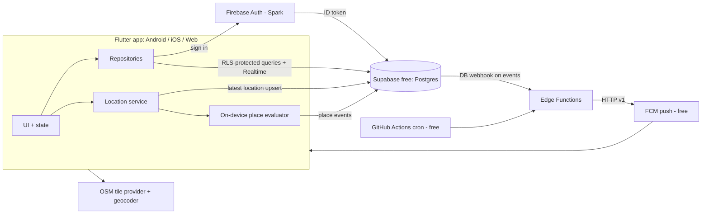

# Circlo — Architecture (DRAFT v0.2 — zero-budget revision)

**Owner constraints (2026-10-12):** monthly budget **$0**; Flutter app for **web, Android, iOS**; Firebase **only for login**; other online data may use a free tier; minors may use the app.

> **Verification status.** Checked against public sources on 2026-10-12: Firebase's plan page lists Cloud Functions under the paid Blaze plan, and a third-party article says Cloud Storage for Firebase needs Blaze since Feb 2026; Supabase free-plan figures below come from third-party summaries, not Supabase's own docs. **Confirm every figure in the official console/docs before building** (risk R-10). Not yet verified: map-tile and geocoding provider terms, Flutter/package versions, store policies.

## 1. Overview
Flutter client (web, Android, iOS) → Firebase Auth (login only, Spark plan) → free-tier backend (Supabase: Postgres + Row Level Security + Realtime + Edge Functions + Storage) → FCM for push. Maps use OpenStreetMap-based tiles (no Google Maps billing). **No paid service is enabled; no billing account is linked anywhere.**



## 2. Technology recommendations
| Area | Choice | Why / cost | Alternatives |
|---|---|---|---|
| Client | Flutter, Riverpod, go_router | One codebase for web/Android/iOS; free | — |
| Login | Firebase Authentication, email+password (Spark) | Owner requirement; free tier | Supabase Auth would remove one dependency (ADR-0001) |
| Data | Supabase free plan: Postgres + RLS + Realtime + Storage | Free; relational model suits circles/history; avoids paid Firebase Functions/Storage | Firestore on Spark (no Functions → no push sending) |
| Server logic | Supabase Edge Functions (Deno/TypeScript) | Free quota; only runs on events, not every location update | Cloud Functions (needs Blaze) |
| Push | Firebase Cloud Messaging | Free | In-app only (no background alerts) |
| Maps | `flutter_map` + free OSM-based tiles | No billing; works on web/Android/iOS | Google Maps (needs billing account) |
| Place search | Free geocoder (e.g. Nominatim/Photon) with rate limiting & caching | Free; usage policies limit autocomplete | Paid geocoding |
| Directions | Open device/web maps app via URL | Free | In-app routing (paid) |
| Background location | Plugin chosen by spike (ADR-0003); free option preferred | Highest technical risk | — |
| CI | GitHub Actions (free quotas for public repos; verify) | — | — |
| Hosting (web) | GitHub Pages / Firebase Hosting free quota / Cloudflare Pages (decide in Phase 6) | Free | — |

## 3. Platform behavior
| Platform | Background sharing | Notes |
|---|---|---|
| Android | Yes (foreground service + persistent notification) | Free distribution via APK/GitHub Releases; Play Store has a one-time developer fee (verify) |
| iOS | Yes ("Always" permission, system indicator) | Public distribution/TestFlight needs a paid Apple Developer account; builds need macOS (cloud CI) |
| Web | **No.** Browsers cannot track in the background. Web = view map/history/manage circles; shares location only while the tab is open (optional) | Web push requires service worker & user permission |

The $0 budget means store fees are outside budget; the code targets all three platforms, **distribution** of iOS/Play follows when the owner can pay (Q1).

## 4. Repository structure (proposed)
```
/app           Flutter project (lib/features/{auth,circles,map,places,history,notifications,settings}, lib/core)
/supabase      migrations (SQL), RLS policies, edge functions, seed (no secrets), tests
/.github       CI workflows (analyze, test, RLS tests, build, secret scan)
/design /docs  documentation
```

## 5. Data model → [docs/data-model.md](docs/data-model.md)

## 6. Server operations (Edge Functions / RPC)
Sensitive actions are SQL `SECURITY DEFINER` RPCs or Edge Functions, never direct client writes: `create_circle`, `join_circle(code)`, `approve_request`, `remove_member`, `transfer_ownership`, `delete_circle`, `rotate_join_code`, `delete_my_history`, `delete_account`, `send_push` (webhook), `retention_cleanup` (cron), `stale_sharing_check` (cron). Typed errors: `invalid_code`, `rate_limited`, `permission_denied`, `circle_full`.

## 7. Place alerts (supersedes earlier server-side proposal) — see [ADR-0002](docs/decisions/ADR-0002-place-detection.md)
Evaluating every location update on a server would exhaust free quotas and Cloud Functions are unavailable on the free plan. Instead:
1. The app syncs the circle's saved places (id, lat, lon, radius) to the device.
2. The **sharing member's device** compares each location fix against those places in app code (no OS geofence limit applies).
3. State machine per (member, place): `outside → inside` after ≥2 consecutive fixes or ≥2 min with accuracy ≤100 m; `inside → outside` after the same persistence beyond radius × 1.2 (hysteresis).
4. On a transition the device inserts a `place_events` row with a unique `visit_id`; a unique constraint `(member, place, visit_id, type)` makes retries idempotent (no duplicates, FR-048).
5. A DB webhook calls an Edge Function that looks up subscribers (members who enabled that place/member/type and are still circle members) and sends FCM + writes in-app notifications.
Limitation: events depend on the member's app getting location updates; if the phone is off/killed, no event (shown as "location unavailable").

## 8. Security & privacy → [docs/security-privacy.md](docs/security-privacy.md)

## 9. Free-tier budget model (to validate in spike)
- DB cap ~500 MB → history points sampled (≥50 m or ≥2 min while moving, none while stationary), default retention 30 days, hard cap per user; visits summarized and points pruned.
- Realtime message cap (~2M/month) and ~200 concurrent connections → throttle: location upsert every 15–30 s only while moving **and** someone is viewing; otherwise 2–5 min or on significant movement. Expected capacity: small groups (families/friends) in early stage; **not** a mass-market scale design.
- Edge Function invocations only on place events/cron (≪500k/month).
- Free Supabase projects auto-pause after ~7 days of inactivity → a free GitHub Actions cron pings the project; a paused backend is a launch risk (R-12).
- Images: client-resized to ≤200 KB, stored in Supabase Storage (1 GB cap).
- A usage dashboard/alerts are checked weekly; the app degrades gracefully ("sync delayed") on limits.

## 10. Reliability & monitoring
Crash reporting: free option to be chosen (Firebase Crashlytics is free but needs the Firebase SDK; decide in Phase 6). Structured logs in Edge Functions; stale-sharing cron (≥15 min no update).

## 11. Local dev, build, deploy, rollback
Supabase CLI + local Docker stack for dev; separate dev and prod Supabase projects (2 free projects) and Firebase project(s) on Spark; secrets (FCM service account, Supabase service key) stored only in Supabase/GitHub secrets, never in repo; migrations are versioned SQL in Git; rollback = redeploy previous tag + reversible migrations; no destructive migration without approval.

## 12. Key risks & trade-offs → [docs/risks.md](docs/risks.md)
Free-tier limits and auto-pause; background-location reliability; client-side event trust; free map/geocoder terms; web cannot track in background; minors/legal.

## 13. Cost-sensitive dependencies (all must stay at $0)
Firebase (Auth, FCM only — no Blaze), Supabase free, map tiles/geocoder free tiers, GitHub free. **Paid items outside budget:** Apple Developer fee, Google Play fee, any plugin licence, custom domain.
